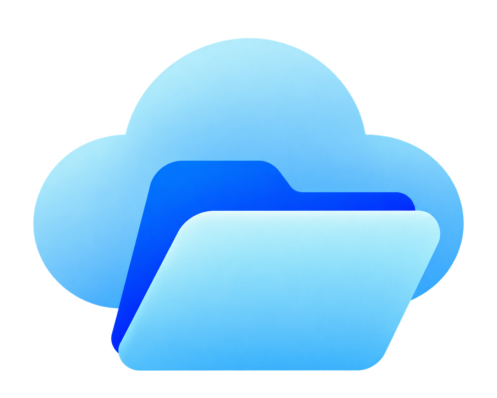

<p align="center">
  
</p>

<h1 align="center">PhoneDrive</h1>

<p align="center">
  <strong>Your Phone. Your Files. Your Personal Cinema & Local Cloud.</strong><br>
  <em>Turn your Android phone and Windows PC into an ultra-fast private cloud & media streaming server over local Wi-Fi. Zero subscriptions. Zero cloud tracking. Pure local speed.</em>
</p>

<p align="center">
  <a href="https://github.com/anhsumankumar/PhoneDrive/releases/latest"></a>
  <a href="LICENSE"></a>
  <a href="https://github.com/anhsumankumar/PhoneDrive"></a>
  <a href="https://github.com/anhsumankumar/PhoneDrive"></a>
  <a href="https://github.com/anhsumankumar/PhoneDrive"></a>
  <a href="https://github.com/anhsumankumar/PhoneDrive"></a>
  <a href="https://github.com/anhsumankumar/PhoneDrive"></a>
</p>

---

## ⚡ Direct Downloads (Latest v1.0.0)

Get the latest pre-compiled binaries for Android and Windows PC:

| Platform | Download | Package Details |
| :--- | :--- | :--- |
| 📱 **Android Phone** | [📥 **Download PhoneDrive-v1.0.0.apk**](https://github.com/anhsumankumar/PhoneDrive/releases/download/v1.0.0/PhoneDrive-v1.0.0.apk) | `APK` • Android 8.0+ up to Android 15 • No root required |
| 💻 **Windows PC (Portable Package)** | [📥 **Download PhoneDrive-PC-v1.0.0.zip**](https://github.com/anhsumankumar/PhoneDrive/releases/download/v1.0.0/PhoneDrive-PC-v1.0.0.zip) | `ZIP` • Windows 10 & 11 (64-bit) • Extract & Run • No setup required |
| 💻 **Windows PC (Direct Binary)** | [📥 **Download PhoneDrive-PC-v1.0.0.exe**](https://github.com/anhsumankumar/PhoneDrive/releases/download/v1.0.0/PhoneDrive-PC-v1.0.0.exe) | `EXE` • Standalone executable binary |
| 🌐 **Web Dashboard** | Open `http://<device-ip>:8080` in any browser | Chrome, Edge, Safari, Firefox, Tablet, Smart TV |

---

## 🌟 What is PhoneDrive?

**PhoneDrive** is a production-grade personal cloud, file manager, and private streaming ecosystem that allows you to access and stream your entire phone or PC media collection across your home or office local network.

No subscriptions, no third-party cloud servers, no size caps, and **zero file duplication**. Your files stay exactly where they are on your device and are served with raw Wi-Fi speed.

---

## 🎬 Key Features

### 🍿 Prime Video & Netflix-Grade Personal Cinema
- **HTTP 206 Byte-Range Streaming:** Instant scrubbing and seeking for 4K UHD, 1080p FHD, and 720p HD videos without buffering delays.
- **Cinematic Featured Hero & Rows:** Auto-curated hero banners, Continue Watching row with exact timestamp progress bars, and Recently Added cards.
- **TV Series & Seasons Grouping:** Automatic regex extraction for series episodes (`S01E02`, `1x02`, `EP03`).
- **Interactive Fullscreen Video Player:**
  - Auto-fading sleek playback controls with cursor hover detection.
  - Interactive scrubbing timeline with live played and buffered bar indicators.
  - **Multi-Track Subtitles:** Auto-discovers embedded tracks and sidecar `.srt` / `.vtt` files with dynamic SubRip-to-WebVTT conversion and full UTF-8 Unicode support (Hindi, English, Spanish, etc.).
  - **Audio Language Switching:** Discovers embedded audio streams via Android `MediaExtractor` / `ffmpeg` and allows instant audio switching.
  - **Variable Playback Speed:** 0.5x, 0.75x, 1x (Normal), 1.25x, 1.5x, 1.75x, 2x with pitch preservation.
  - **Picture-in-Picture (PiP):** Multitask while watching videos in a floating window.
  - **Power User Shortcuts:** Space/K (Play/Pause), Left/Right (-10s / +10s), Up/Down (Volume), M (Mute), F (Fullscreen), C (Subtitles toggle).

### 📁 High-Speed File Explorer & Cloud Storage
- **Direct Storage Access Framework (SAF):** Grants explicit access to phone folders (DCIM, Movies, Downloads, Documents) with zero duplicate file copying.
- **Full File Management:** Upload files via drag-and-drop, download single or bulk files, rename, and delete directly from the browser.
- **Breadcrumb Navigation & Search:** Instant keyword filtering and nested directory exploration.
- **High-Resolution Photo Lightbox:** Grid view with thumbnail caching and zoomable previewer.

### 🔐 Fortress-Grade Security & QR Pairing
- **Instant 1-Tap QR Pairing:** Connect any browser or TV in seconds by scanning a dynamic QR code.
- **Master PIN / Password Protection:** Secure authorization with salted SHA-256 password hashing.
- **Brute-Force Attack Prevention:** IP-based rate limiting with automatic lockout after consecutive failed attempts.
- **Cryptographic Session Tokens:** Secure 256-bit authorization tokens with configurable expiration.

### 🖥️ Cross-Platform Ecosystem: Android + Windows PC
- **Android App:** Built with modern **Kotlin & Jetpack Compose**, featuring foreground service persistence, battery optimization handling, and live Wi-Fi IP display.
- **Windows PC Daemon & GUI:** Built with **PySide6, FastAPI, and Uvicorn**, featuring a modern dark-mode control window, system tray integration, port selector, and custom folder management.
- **Unified Web Dashboard:** Built with **React 19, TypeScript, and Tailwind CSS v4**, delivering a consistent luxury interface whether connected to a Phone or a PC server.

---

## 🏗️ System Architecture

```
+-----------------------------------------------------------------------------------+
|                         Authorized Browser (Laptop / PC / Smart TV)               |
|   +---------------------------------------------------------------------------+   |
|   |         React 19 + TypeScript + Tailwind CSS v4 Unified Dashboard         |   |
|   |  • Cinema Suite (Featured Hero, Continue Watching, TV Series, Watchlist)  |   |
|   |  • Cinematic Video Player (HTTP 206 Range, Subtitles, Audio Switcher, PiP)|   |
|   |  • File Manager (Photo Lightbox, Chunked Uploads, Breadcrumb Navigation)  |   |
|   +---------------------------------------------------------------------------+   |
+-----------------------------------------+-----------------------------------------+
                                          | Local Wi-Fi / LAN (REST API & HTTP Range)
         +--------------------------------+--------------------------------+
         |                                                                 |
+--------v---------------------------------------+   +---------------------v---------------------------------------+
|          Android Phone (PhoneDrive App)        |   |           Windows PC (PhoneDrive-PC)                        |
| • Jetpack Compose Native Dark/Light UI         |   | • PySide6 Dark Glassmorphic Desktop GUI                     |
| • Foreground Service with Persistent State     |   | • FastAPI + Uvicorn Async HTTP Engine                       |
| • NanoHTTPD HTTP 206 Streaming Engine          |   | • Pillow & ffmpeg Thumbnail Generator                       |
| • Android Storage Access Framework (SAF)       |   | • SQLite Local Progress & Settings Store                    |
| • MediaExtractor & MediaMetadataRetriever      |   | • System Tray Minimization & Port Selector                  |
+------------------------------------------------+   +-------------------------------------------------------------+
```

---

## 📡 REST API Reference

Both Android and PC servers expose a compatible, versioned REST API at `/api/v1/*`:

### Media & Cinema Endpoints
| Endpoint | Method | Auth | Description |
| :--- | :---: | :---: | :--- |
| `/api/v1/media` | `GET` | Yes | Get categorized media library (featured, continue watching, movies, series) |
| `/api/v1/media/{id}` | `GET` | Yes | Get file metadata, duration, resolution, audio & subtitle tracks |
| `/api/v1/media/{id}/stream` | `GET` | Yes | Stream video with HTTP 206 Range requests |
| `/api/v1/media/{id}/thumbnail` | `GET` | Yes | Get cached high-resolution video thumbnail (JPEG) |
| `/api/v1/media/{id}/tracks` | `GET` | Yes | List embedded and sidecar audio and subtitle tracks |
| `/api/v1/media/{id}/subtitles/{trackId}` | `GET` | Yes | Stream subtitle dynamically converted to WebVTT (`text/vtt`) |
| `/api/v1/media/{id}/playback-progress` | `GET/POST/DELETE`| Yes | Manage watched position, duration, and completion status |
| `/api/v1/media/{id}/watchlist` | `POST` | Yes | Toggle item in personal watchlist |

### Storage & Authentication Endpoints
| Endpoint | Method | Auth | Description |
| :--- | :---: | :---: | :--- |
| `/api/v1/health` | `GET` | No | Server status, version, and uptime |
| `/api/v1/auth/login` | `POST` | No | Authenticate with master password; returns session token |
| `/api/v1/pairing/complete` | `POST` | No | Complete QR code pairing using one-time token |
| `/api/v1/auth/logout` | `POST` | Yes | Invalidate active session token |
| `/api/v1/session` | `GET` | Yes | Verify session validity and host device details |
| `/api/v1/folders` | `GET` | Yes | List user-authorized shared folders |
| `/api/v1/files` | `GET` | Yes | Browse directory contents (`folderId`, `parentId`) |
| `/api/v1/files/{id}/content` | `GET` | Yes | Download or stream file content |
| `/api/v1/files/upload` | `POST` | Yes | Multi-part file upload to target directory |
| `/api/v1/files/{id}/rename` | `POST` | Yes | Rename file or directory |
| `/api/v1/files/{id}` | `DELETE` | Yes | Delete file or directory |

---

## 🛠️ Building From Source

### 1. Web Dashboard
```bash
cd web-dashboard
npm install
npm run build
```

### 2. Android App
```bash
cd android
./gradlew assembleDebug
```
The resulting APK will be at `android/app/build/outputs/apk/debug/app-debug.apk`.

### 3. Windows PC Executable
```bash
pip install -r pc/requirements.txt
pip install pyinstaller
python pc/build_exe.py
```
The packaged standalone executable will be generated at `pc/dist/PhoneDrive-PC/PhoneDrive-PC.exe`.

---

## 🔒 Privacy & Security Commitment

- **100% Local & Private:** Absolutely zero data or telemetry leaves your local network.
- **Sandbox Compliance:** The server strictly obeys Android SAF and Windows folder authorization boundaries. No access is granted outside authorized directories.
- **Timing Attack Resistance:** Passwords and tokens use constant-time equality comparisons (`MessageDigest.isEqual` / `secrets.compare_digest`).

---

## 📄 License

This project is licensed under the [MIT License](LICENSE) — feel free to use, modify, and distribute.

---

<p align="center">
  Crafted with ❤️ by <strong><a href="https://github.com/anhsumankumar">Anshuman Kumar</a></strong>
</p>
